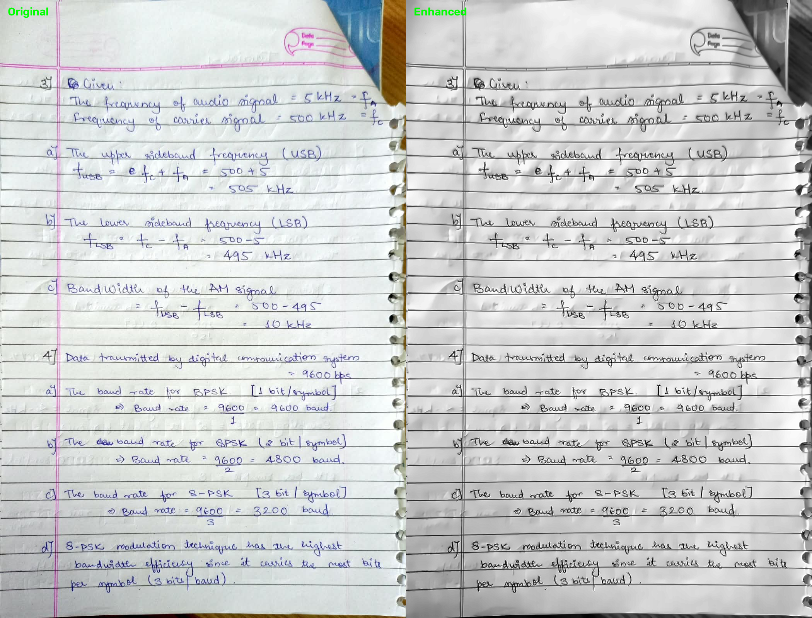

# ImageEnhancement

A classical Computer Vision project for enhancing document images and assessing their visual quality using OpenCV. The application provides image quality analysis, document enhancement, batch processing, and comparison reports through a simple command-line interface.

---

## Project Overview

Poor-quality document images often suffer from low contrast, noise, uneven lighting, and blur, making them difficult to read or process. ImageClarity improves the visual quality of scanned or photographed documents using traditional Computer Vision techniques.

The project analyzes document images, applies enhancement operations, and generates reports comparing image quality before and after processing.

---

## Features

- Document image enhancement
- Brightness and contrast analysis
- Blur detection using Laplacian Variance
- Noise reduction
- CLAHE-based contrast enhancement
- Image sharpening
- Multiple enhancement modes
- Batch processing of document images
- JSON quality reports
- CSV batch reports
- Side-by-side comparison image generation
- Command-line interface

---

## Technologies Used

- Python 3
- OpenCV
- NumPy
- PyTest

---

## Project Structure

```
ImageClarity
│
├── data/
│   └── documents/
│
├── outputs/
│
├── src/
│   ├── batch_processor.py
│   ├── config.py
│   ├── decision_engine.py
│   ├── enhancement.py
│   ├── image_loader.py
│   ├── quality_metrics.py
│   └── report_generator.py
│
├── tests/
│
├── main.py
├── requirements.txt
└── README.md
```

---

## Installation

### Clone the repository

```bash
git clone https://github.com/SaniaNasreen/ImageClarity.git

cd ImageClarity
```

### Create a virtual environment

Windows

```bash
python -m venv .venv
```

Activate

Command Prompt

```bash
.venv\Scripts\activate
```

PowerShell

```powershell
.\.venv\Scripts\Activate.ps1
```

### Install dependencies

```bash
pip install -r requirements.txt
```

---

## Usage

### Inspect an image

```bash
python main.py inspect --input data/documents/sample1.jpeg
```

### Enhance a single image

```bash
python main.py enhance --input data/documents/sample1.jpeg --output outputs
```

### Batch Processing

```bash
python main.py batch --input data/documents --output outputs
```

---

## Output

The application generates:

```
outputs/

sample1_enhanced.png

sample1_comparison.png

sample1_comparison.json

batch_report.csv
```

---

## Working Methodology

1. Load the input document image.
2. Measure image quality metrics such as brightness, contrast, and blur.
3. Apply preprocessing techniques including:
   - Noise Reduction
   - CLAHE Contrast Enhancement
   - Image Sharpening
4. Generate the enhanced document image.
5. Compare image quality before and after enhancement.
6. Save enhancement results and quality reports.

---

## Image Enhancement Pipeline

```
Input Image

↓

Quality Analysis

↓

Noise Reduction

↓

CLAHE Contrast Enhancement

↓

Image Sharpening

↓

Enhanced Image

↓

Quality Report Generation
```

---

## Enhancement Modes

### Balanced

- Noise Reduction
- CLAHE
- Sharpening

### Grayscale

- Noise Reduction
- CLAHE

### Binary

- Adaptive Thresholding
- Document Binarization

---

## Results

The project successfully

- Enhanced document readability
- Increased image contrast
- Reduced image noise
- Improved sharpness
- Generated comparison reports
- Supported processing of multiple images

---

## Future Scope

Possible future enhancements include:

- Perspective correction
- OCR integration
- Deep learning based enhancement
- Automatic document classification
- Web application interface
- PDF document support

---

## 📸 Sample Results

The following example demonstrates the enhancement performed by **ImageClarity**.

### Document Enhancement Comparison

<p align="center">
  
</p>

The comparison above shows the original document image alongside the enhanced version after applying denoising, CLAHE-based contrast enhancement, and image sharpening.

---

## Author

**Sania Nasreen**

B.Tech CSE (AI & ML)

5th Semester

VIT Bhopal University

GitHub:
https://github.com/SaniaNasreen
